<div align="center">

  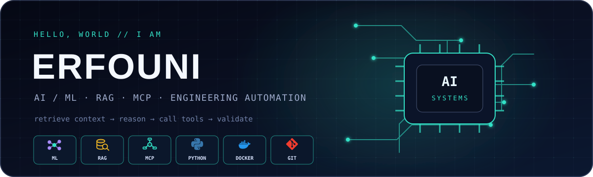

  <br />

  

  <br />

  [](https://docs.github.com/en/get-started/exploring-integrations/about-building-integrations)
  [](https://github.com/Erfouni/solidworks-GPT-plugin)

</div>

## `> whoami`

I'm **Erfouni**, an AI/ML builder interested in systems that do more than generate text—they retrieve useful context, call tools, automate workflows, validate outcomes, and produce real-world results.

- 🧠 Building with **machine learning, RAG, and agentic workflows**
- 🔌 Connecting models to tools and knowledge through **MCP and REST APIs**
- 🐳 Packaging ideas with **Python and Docker**
- ⚙️ Exploring **AI-assisted CAD and SolidWorks automation**
- 🧪 Current operating mode: _prototype → test → break → learn → ship_

<!-- open-source-impact:start -->

## `> contributions --merged`

<p align="center">
<a href="https://github.com/search?q=author%3AErfouni+is%3Apr+is%3Amerged+-user%3AErfouni&type=pullrequests">
  <picture>
    <source media="(prefers-color-scheme: dark)" srcset="./assets/contributions/impact-compact-dark-6002d08b0960.svg" />
    
  </picture>
</a>
</p>

<p align="center">
  <a href="https://github.com/py-pdf/pypdf/pulls?q=is%3Apr+is%3Amerged+author%3AErfouni">
    <picture>
    <source media="(prefers-color-scheme: dark)" srcset="./assets/contributions/py-pdf--pypdf-compact-dark-cc76f125dc7f.svg" />
    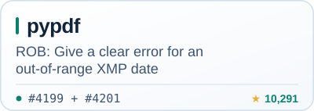
  </picture>
  </a>
  <a href="https://github.com/fonttools/fonttools/pull/4254">
    <picture>
    <source media="(prefers-color-scheme: dark)" srcset="./assets/contributions/fonttools--fonttools-compact-dark-866842dd57a7.svg" />
    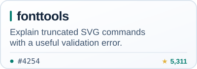
  </picture>
  </a>
  <a href="https://github.com/mikedh/trimesh/pull/2619">
    <picture>
    <source media="(prefers-color-scheme: dark)" srcset="./assets/contributions/mikedh--trimesh-compact-dark-9d78a878173f.svg" />
    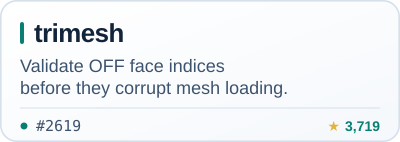
  </picture>
  </a>
  <a href="https://github.com/gumyr/build123d/pull/1489">
    <picture>
    <source media="(prefers-color-scheme: dark)" srcset="./assets/contributions/gumyr--build123d-compact-dark-1776293928ea.svg" />
    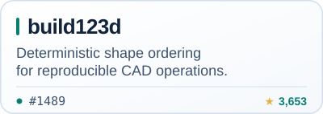
  </picture>
  </a>
  <a href="https://github.com/cantools/cantools/pull/857">
    <picture>
    <source media="(prefers-color-scheme: dark)" srcset="./assets/contributions/cantools--cantools-compact-dark-bd12a0ebd221.svg" />
    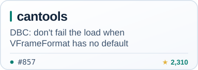
  </picture>
  </a>
  <a href="https://github.com/erocarrera/pefile/pull/633">
    <picture>
    <source media="(prefers-color-scheme: dark)" srcset="./assets/contributions/erocarrera--pefile-compact-dark-1f65d39baaee.svg" />
    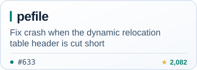
  </picture>
  </a>
  <a href="https://github.com/hashgraph-online/awesome-codex-plugins/pull/313">
    <picture>
    <source media="(prefers-color-scheme: dark)" srcset="./assets/contributions/hashgraph-online--awesome-codex-plugins-compact-dark-18e8575056fa.svg" />
    
  </picture>
  </a>
  <a href="https://github.com/mozman/ezdxf/pulls?q=is%3Apr+is%3Amerged+author%3AErfouni">
    <picture>
    <source media="(prefers-color-scheme: dark)" srcset="./assets/contributions/mozman--ezdxf-compact-dark-801880171b5f.svg" />
    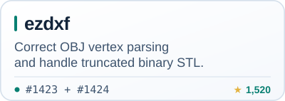
  </picture>
  </a>
  <a href="https://github.com/nipy/nibabel/pulls?q=is%3Apr+is%3Amerged+author%3AErfouni">
    <picture>
    <source media="(prefers-color-scheme: dark)" srcset="./assets/contributions/nipy--nibabel-compact-dark-d2ff17a22f84.svg" />
    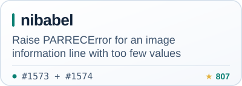
  </picture>
  </a>
</p>

<details>
<summary>Show 27 more projects</summary>

<p align="center">
  <a href="https://github.com/mathandy/svgpathtools/pull/253">
    <picture>
    <source media="(prefers-color-scheme: dark)" srcset="./assets/contributions/mathandy--svgpathtools-compact-dark-895c6722084d.svg" />
    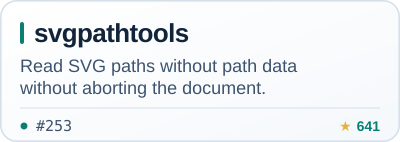
  </picture>
  </a>
  <a href="https://github.com/dranjan/python-plyfile/pull/91">
    <picture>
    <source media="(prefers-color-scheme: dark)" srcset="./assets/contributions/dranjan--python-plyfile-compact-dark-448cc3bc1129.svg" />
    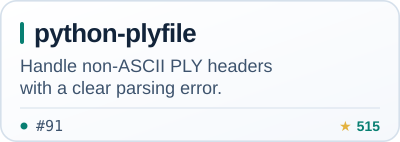
  </picture>
  </a>
  <a href="https://github.com/gopherium/gophenberg/pulls?q=is%3Apr+is%3Amerged+author%3AErfouni">
    <picture>
    <source media="(prefers-color-scheme: dark)" srcset="./assets/contributions/gopherium--gophenberg-compact-dark-c46b0b305773.svg" />
    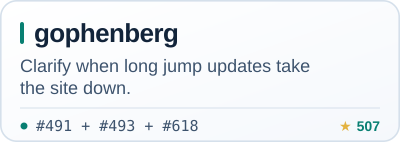
  </picture>
  </a>
  <a href="https://github.com/eea/odfpy/pulls?q=is%3Apr+is%3Amerged+author%3AErfouni">
    <picture>
    <source media="(prefers-color-scheme: dark)" srcset="./assets/contributions/eea--odfpy-compact-dark-5273199a414e.svg" />
    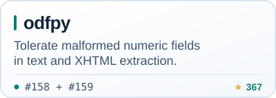
  </picture>
  </a>
  <a href="https://github.com/flint-fyi/flint/pulls?q=is%3Apr+is%3Amerged+author%3AErfouni">
    <picture>
    <source media="(prefers-color-scheme: dark)" srcset="./assets/contributions/flint-fyi--flint-compact-dark-e5808ac61b6a.svg" />
    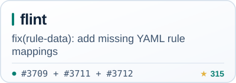
  </picture>
  </a>
  <a href="https://github.com/oras-project/oras-go/pull/1697">
    <picture>
    <source media="(prefers-color-scheme: dark)" srcset="./assets/contributions/oras-project--oras-go-compact-dark-005d0fe4009d.svg" />
    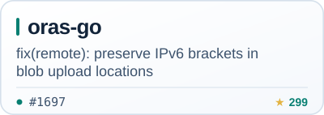
  </picture>
  </a>
  <a href="https://github.com/pycollada/pycollada/pull/165">
    <picture>
    <source media="(prefers-color-scheme: dark)" srcset="./assets/contributions/pycollada--pycollada-compact-dark-9dcbe70c7399.svg" />
    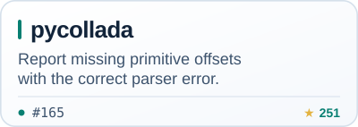
  </picture>
  </a>
  <a href="https://github.com/ryanrosello-og/playwright-slack-report/pull/494">
    <picture>
    <source media="(prefers-color-scheme: dark)" srcset="./assets/contributions/ryanrosello-og--playwright-slack-report-compact-dark-7c0abb61bb06.svg" />
    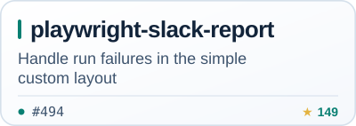
  </picture>
  </a>
  <a href="https://github.com/Avenx-JS/avenx-js/pulls?q=is%3Apr+is%3Amerged+author%3AErfouni">
    <picture>
    <source media="(prefers-color-scheme: dark)" srcset="./assets/contributions/avenx-js--avenx-js-compact-dark-b3cb00e4d4e3.svg" />
    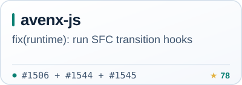
  </picture>
  </a>
  <a href="https://github.com/gopherium/gouncer/pull/105">
    <picture>
    <source media="(prefers-color-scheme: dark)" srcset="./assets/contributions/gopherium--gouncer-compact-dark-61502e32d54c.svg" />
    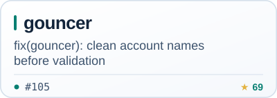
  </picture>
  </a>
  <a href="https://github.com/8f4e/8f4e/pulls?q=is%3Apr+is%3Amerged+author%3AErfouni">
    <picture>
    <source media="(prefers-color-scheme: dark)" srcset="./assets/contributions/8f4e--8f4e-compact-dark-ef1ca34a39f1.svg" />
    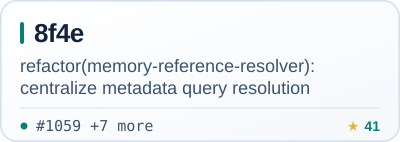
  </picture>
  </a>
  <a href="https://github.com/CallMeJones/blender-agent-bridge/pull/7">
    <picture>
    <source media="(prefers-color-scheme: dark)" srcset="./assets/contributions/callmejones--blender-agent-bridge-compact-dark-570275da38d4.svg" />
    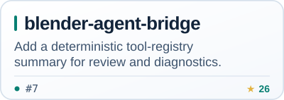
  </picture>
  </a>
  <a href="https://github.com/GustavoBaranda/chatflow-agent/pull/95">
    <picture>
    <source media="(prefers-color-scheme: dark)" srcset="./assets/contributions/gustavobaranda--chatflow-agent-compact-dark-794905bed9a8.svg" />
    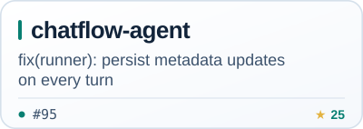
  </picture>
  </a>
  <a href="https://github.com/BistaDinesh03/critique/pull/89">
    <picture>
    <source media="(prefers-color-scheme: dark)" srcset="./assets/contributions/bistadinesh03--critique-compact-dark-3d911e71293a.svg" />
    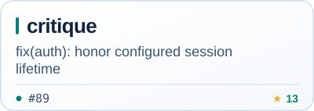
  </picture>
  </a>
  <a href="https://github.com/whut09/Awesome-AI-Engineering-Agents/pull/2">
    <picture>
    <source media="(prefers-color-scheme: dark)" srcset="./assets/contributions/whut09--awesome-ai-engineering-agents-compact-dark-120acb3cb1a8.svg" />
    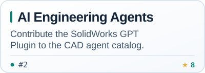
  </picture>
  </a>
  <a href="https://github.com/alessioricco/Certo/pulls?q=is%3Apr+is%3Amerged+author%3AErfouni">
    <picture>
    <source media="(prefers-color-scheme: dark)" srcset="./assets/contributions/alessioricco--certo-compact-dark-4f687834147c.svg" />
    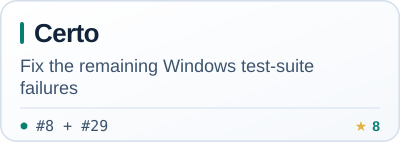
  </picture>
  </a>
  <a href="https://github.com/oscarbol09/jvm-mcp/pulls?q=is%3Apr+is%3Amerged+author%3AErfouni">
    <picture>
    <source media="(prefers-color-scheme: dark)" srcset="./assets/contributions/oscarbol09--jvm-mcp-compact-dark-39f47559bcf6.svg" />
    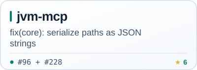
  </picture>
  </a>
  <a href="https://github.com/PicadoLabs/build-with-ai/pull/175">
    <picture>
    <source media="(prefers-color-scheme: dark)" srcset="./assets/contributions/picadolabs--build-with-ai-compact-dark-233622b8deb3.svg" />
    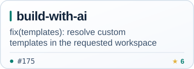
  </picture>
  </a>
  <a href="https://github.com/duramson/eeg-bewegungsdaten/pull/8">
    <picture>
    <source media="(prefers-color-scheme: dark)" srcset="./assets/contributions/duramson--eeg-bewegungsdaten-compact-dark-1128069a9bf3.svg" />
    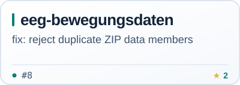
  </picture>
  </a>
  <a href="https://github.com/agrvasu05/DevCrew/pull/12">
    <picture>
    <source media="(prefers-color-scheme: dark)" srcset="./assets/contributions/agrvasu05--devcrew-compact-dark-e67072dc452f.svg" />
    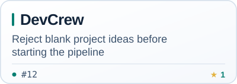
  </picture>
  </a>
  <a href="https://github.com/BiTech5/repotrace/pull/2">
    <picture>
    <source media="(prefers-color-scheme: dark)" srcset="./assets/contributions/bitech5--repotrace-compact-dark-c0753716a295.svg" />
    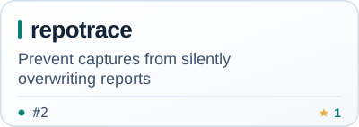
  </picture>
  </a>
  <a href="https://github.com/layer8labs8/quantpreflight/pull/18">
    <picture>
    <source media="(prefers-color-scheme: dark)" srcset="./assets/contributions/layer8labs8--quantpreflight-compact-dark-c24bdc3a6b1a.svg" />
    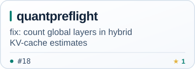
  </picture>
  </a>
  <a href="https://github.com/Logixia/logixia/pull/50">
    <picture>
    <source media="(prefers-color-scheme: dark)" srcset="./assets/contributions/logixia--logixia-compact-dark-448f6f7ed017.svg" />
    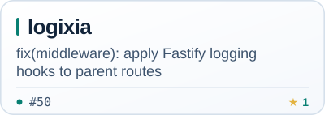
  </picture>
  </a>
  <a href="https://github.com/Sh1n1230/SpotifyEmbedded/pull/384">
    <picture>
    <source media="(prefers-color-scheme: dark)" srcset="./assets/contributions/sh1n1230--spotifyembedded-compact-dark-8eeb9e187a56.svg" />
    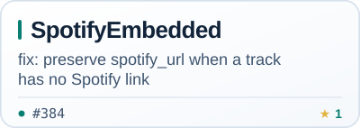
  </picture>
  </a>
  <a href="https://github.com/yangflow/oriel/pull/478">
    <picture>
    <source media="(prefers-color-scheme: dark)" srcset="./assets/contributions/yangflow--oriel-compact-dark-6f10373367bc.svg" />
    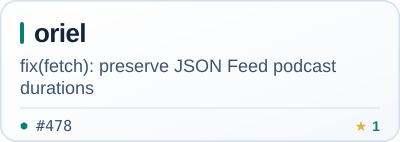
  </picture>
  </a>
  <a href="https://github.com/deBilla/peek/pull/9">
    <picture>
    <source media="(prefers-color-scheme: dark)" srcset="./assets/contributions/debilla--peek-compact-dark-a8c463ebb6a1.svg" />
    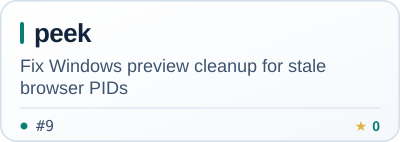
  </picture>
  </a>
  <a href="https://github.com/nyactl/dok-for-confluence/pull/22">
    <picture>
    <source media="(prefers-color-scheme: dark)" srcset="./assets/contributions/nyactl--dok-for-confluence-compact-dark-9ff4a9197ad4.svg" />
    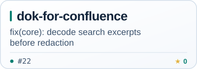
  </picture>
  </a>
</p>

</details>

<p align="center"><a href="https://github.com/search?q=author%3AErfouni+is%3Apr+is%3Amerged+-user%3AErfouni&type=pullrequests">Explore all merged contributions ↗</a></p>

<!-- open-source-impact:end -->

## `> stack --verbose`

<div align="center">

### AI & intelligent systems


### Code, containers & tools


### Engineering meets AI


</div>

## `> ls ./what-i-build`

| System | What makes it interesting |
|:--|:--|
| 🧠 **AI knowledge systems** | Retrieval pipelines that give models the right context before they answer |
| 🔌 **Tool-using agents** | MCP and API integrations that let AI take useful, controlled action |
| ⚙️ **Engineering automation** | Intelligent workflows for CAD, design rules, and technical knowledge |
| 📦 **Reproducible services** | Python applications packaged to behave the same way outside my laptop |

## `> cat featured_build.md`

### Knowledge-backed engineering agents

I build OpenAI Codex plugins and MCP systems that connect AI-assisted SolidWorks workflows to curated engineering knowledge, deterministic validation, and consent-based learning.

[](https://github.com/Erfouni/solidworks-GPT-plugin)
[](https://github.com/Erfouni/solidworks-drawing-api-2026)
[](https://github.com/Erfouni/connect-gpt-to-all-models-with-openrouter)
[](https://github.com/Erfouni/helios-llm-orchestrator)

```text
design request
    └──► retrieve standards + known patterns
              └──► reason with constraints
                        └──► call CAD tools
                                  └──► validate → learn → improve
```

## `> ./runtime_diagnostics.py`

```python
def build_idea(idea):
    while not idea.works:
        idea = debug(idea, coffee=True)
    return dockerize(idea)

# "Works on my machine" is a bug report, not a deployment strategy.
```

## `> ./pacman --eat-contributions`

<div align="center">

  <picture>
    <source media="(prefers-color-scheme: dark)" srcset="https://raw.githubusercontent.com/Erfouni/Erfouni/output/pacman-contribution-graph-dark.svg" />
    <source media="(prefers-color-scheme: light)" srcset="https://raw.githubusercontent.com/Erfouni/Erfouni/output/pacman-contribution-graph.svg" />
    
  </picture>

  <sub>Waka waka — one contribution at a time.</sub>

</div>

---

<div align="center">

  <sub>Always learning. Occasionally debugging the debugger.</sub>

</div>
